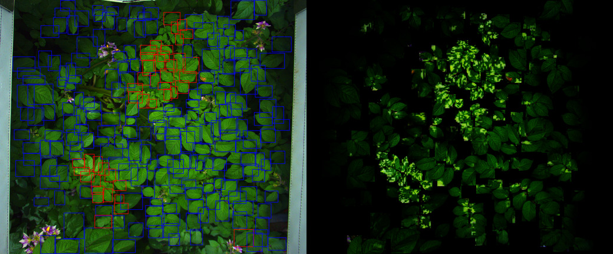

This project visualises disease symptoms, specifically those of Potato virus Y (PVY) in potato leaves, by combining a truncated ResNet with a max-tree (component tree). The CNN provides discriminative features for each 16×16 image patch, and the max-tree groups these patches into regions of varying size and shape, which are then classified and highlighted directly. Users can adjust the region size to move between fine symptom details and whole-leaf context.

See `data.py` for the expected dataset layout and `config.py` for the settings.

# Installation

```
pip install -r requirements.txt
```

# Building mta.so

The max-tree module (needs CMake and a C++ compiler; `run_pipeline.sh` runs
this too):

```
./build_mta.sh
```

# Example

1. Train the models for a cultivar:

   ```
   python finetune.py --cultivar Rudolph
   python train_logreg.py patch --cultivar Rudolph --checkpoint model_Rudolph_<time>.pt
   python train_logreg.py component --cultivar Rudolph --patch-logreg patch_logreg_Rudolph_<time>.npz
   ```

   Alternatively, build `mta.so` and run these three steps with one command
   (the models are then saved in `runs/Rudolph_<time>/`):

   ```
   ./run_pipeline.sh Rudolph
   ```

2. Visualise an image (side-by-side images):

   ```
   python visualise_relevance.py image.png --patch-logreg patch_logreg_Rudolph_<time>.npz --side-by-side
   python visualise_relevance.py image.png --component-logreg component_logreg_Rudolph_<time>.npz --side-by-side
   ```

   If you used `run_pipeline.sh`, use the models in its folder instead, e.g.
   `runs/Rudolph_<time>/patch_logreg_Rudolph.npz` (no time in the file names).

---

The original Python code and this readme was rewritten by Claude.ai.
